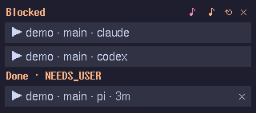

# herdr-blocked-hud

> **Personal pilot project.** I wrote this for my own computer and the
> tools I run on it (Lubuntu with LXQt and Openbox, X11, WezTerm, Herdr
> 0.9.5). It is made specially for the persistent agents of my
> [hcom fork](https://github.com/orgoj/hcom/blob/orgoj-rebuild/docs/agent.md),
> whose replies end with a `STATUS:` line. It may not work anywhere else, and
> I do not plan to support other setups. It is not an official [Herdr](https://github.com/herdrdev/herdr)
> project and is not affiliated with it. Provided as is, without warranty of
> any kind; see [LICENSE](LICENSE).

Small always-on-top window for Linux/X11 that lists Herdr agents that need
you:

- **Blocked**: Herdr detected an approval or question prompt. A sound plays
  when a pane becomes blocked.
- **Done**: the agent finished and you have not looked at it for
  `done.after_seconds` (default 5 s), grouped by the value of its final
  `STATUS:` line. By default a row leaves once you view the pane; a status
  value set to `sticky` stays until the agent works again. A separate,
  switchable sound plays; a status value can play the blocked sound instead.



Click a row to focus that pane in Herdr and raise its terminal window; `×`
or a right click dismisses a done row. On the top line, the red `♪` mutes
and unmutes the blocked sound and the orange `♪` the done sound (each struck
through and grey while muted; the HUD still appears), `↻` restarts the
HUD with the same command (so a newly installed version starts) and `×`
quits it. Drag the HUD with the left mouse button to move it; drag its left
or right edge (the pointer turns into a resize arrow) to change its width,
between 200 px and the monitor width. Position, width and mute are
remembered across runs (see [State file](#state-file)). The
window disappears when nothing is listed. A blocked pane stays listed until
it is no longer blocked, even while it is on screen in Herdr. If Herdr
cannot be reached for three polls, a grey error row appears.

All running local Herdr sessions are watched (`herdr session list --json`);
the session name is shown only when more than one session runs.

## Requirements

- Python 3.11+ with Tk (`python3-tk`), no other Python packages
- `herdr` on `PATH`, X11 with `wmctrl`, `xrandr`, and `paplay`
- Optional status-bar icon: a D-Bus session bus and a panel that shows
  StatusNotifierItems (LXQt, KDE Plasma, ...)
- Tested only on Lubuntu (LXQt + Openbox) with Herdr 0.9.5

## Status-bar icon

The HUD puts a dot in the panel: grey when nothing is listed, orange when
only done rows are listed, red when a pane is blocked; the tooltip gives the
counts and says which sound is muted. A left click hides a shown HUD or shows
a hidden one (also with nothing listed, e.g. to move it); the next new
blocked or done event shows it again. A right click opens a menu with Mute
blocked sound, Mute done sound, Restart and Quit. Without a session bus or a StatusNotifier panel the HUD
runs without the icon; it registers when the panel starts later or restarts.

## Install and run

Recommended: let your own coding agent do it. This project fits one setup,
so the agent can check and adapt it to yours. For example:

> Install https://github.com/orgoj/herdr-blocked-hud for me. First review the
> code for safety (what it runs, reads and sends), then install the latest
> tagged release in the way that fits this machine, set up autostart for my
> desktop, and adapt `~/.config/herdr-blocked-hud/config.toml` to my setup.
> Also add the STATUS-line instruction from its README to my agent
> instructions if I do not have one yet.

Manual install: a tagged release as a uv tool (a copy, so work in the
checkout does not affect the running HUD). The Python must include Tk; uv's
managed CPython does.

```bash
uv tool install --python 3.14 git+https://github.com/orgoj/herdr-blocked-hud@v0.1.20
herdr-blocked-hud                 # run; a second instance exits with status 1
herdr-blocked-hud --demo          # sample rows for 8 s and both sounds (check placement)
herdr-blocked-hud --check-config  # validate the config file and exit
```

Start at LXQt login:

```bash
cp contrib/herdr-blocked-hud.desktop ~/.config/autostart/
```

The autostart entry runs `herdr-blocked-hud` from `PATH`; `~/.local/bin` (where
uv puts tool commands) must be on the session `PATH` (Ubuntu's `~/.profile`
adds it when it exists), as must `herdr`.

### As a Herdr plugin

The repository is also a Herdr plugin (`herdr-plugin.toml`, Herdr 0.7.5+,
Linux), listed on the [Herdr marketplace](https://herdr.dev/plugins/):

```bash
herdr plugin install orgoj/herdr-blocked-hud
```

There is no build step; the HUD runs from the plugin checkout with
`python3 -m herdr_blocked_hud`. A startup hook starts it, detached, whenever a
Herdr server starts, and the action `Start Blocked HUD`
(`herdr plugin action invoke orgoj.blocked-hud.start`) starts it by hand; a
HUD that already runs keeps running. Its output goes to `hud.log` in the
plugin state directory. The Herdr server's environment must provide
`python3` with Tk, `setsid` (util-linux) and the X11 `DISPLAY`, plus the tools
listed under Requirements. After `herdr plugin update`, quit the HUD (`×`)
and start it with the action, so the new version runs; `↻` keeps running
the old installation and fails once Herdr has removed it.

To run from a checkout during development, without installing:
`bin/herdr-blocked-hud` (or `python3 -m herdr_blocked_hud`).

Releases: before starting the work, `bin/bump-version X.Y.Z` (sets `version`
in `pyproject.toml` and `herdr-plugin.toml` and the install tag above), so a build run from the
checkout is never mistaken for the installed release; then do the work, run
the tests, commit, and tag `vX.Y.Z`. Only changes to what is installed or run
(`herdr_blocked_hud/`, `pyproject.toml`, `herdr-plugin.toml`, `bin/`) are
releases; README, docs, tests and backlog changes need no bump or tag.

## State file

The dragged position, the dragged width and the mute state are saved to
`~/.local/state/herdr-blocked-hud/state.json` (respects `XDG_STATE_HOME`),
never to the config file. The position is stored as the distance from the
configured `corner`; after a `corner` change it is ignored, and the HUD is
always kept fully on the monitor it was dragged to (on the nearest one when
that monitor is gone). Config `width` stays the default; a dragged width is
ignored after a change of config `width`. Delete the file to reset them all. `--demo`
neither reads nor writes it.

## Configuration

`~/.config/herdr-blocked-hud/config.toml` (respects `XDG_CONFIG_HOME`). Every
key is optional; `contrib/config.toml` lists all keys with their defaults.
Unknown keys, wrong types and invalid regexes stop the HUD at startup.

| Key | Default | Meaning |
|---|---|---|
| `poll_interval` | `1.0` | Seconds between polls |
| `wm_class` | `"herdr.herdr"` | Exact `wmctrl -lx` class of the Herdr terminal window, used when the process tree finds none and no other session has a client; `""` disables |
| `blocked_sound` | `"builtin"` | `"builtin"` (the HUD's own urgent two-tone call), a sound file for `paplay`, or `""` to disable |
| `done_sound` | `"builtin"` | `"builtin"` (the HUD's own soft rising chime), a sound file, or `""` to disable |
| `corner` | `"top-right"` | `top-right`, `top-left`, `bottom-right`, `bottom-left` of the primary monitor |
| `margin_x`, `margin_y` | `24`, `36` | Pixels from that corner |
| `width` | `320` | Window width in pixels (positive; margins must not be negative); shown within 200 px and the monitor width; an edge drag overrides it |
| `done.after_seconds` | `5` | How long an agent stays done before it is listed (positive) |
| `done.sound_enabled` | `true` | Done sound on/off, independent of the blocked sound (and of statuses set to it) |
| `done.status_regex` | `'^\s*STATUS:\s*(\S+)'` | Finds the agent's status line; group 1 is the status value |
| `done.modes` | `{}` | Mode per status value: `"transient"`, `"sticky"` or `"hide"`, or a table `{ mode = "...", sound = "blocked" }` (sound `"done"` by default) |
| `done.default_mode` | `"transient"` | Mode of status values not in `done.modes` |
| `done.no_status_mode` | `"transient"` | Mode of a reply without a status line, or a failed read |
| `done.read_lines` | `80` | Rows of pane output read per completion |

### Done sections by status value

When an agent finishes, the HUD reads its last `done.read_lines` rows once,
takes the bottom-most line matching `done.status_regex`, and lists the agent
under a `Done · <value>` section (plain `Done` without a status line). The
value's mode decides how long the row stays:

- `transient`: until you view the pane (Herdr marks it seen), as Herdr does.
- `sticky`: also after you viewed it, until the agent works again or
  finishes anew; a pane viewed before `done.after_seconds` is still listed.
- `hide`: never listed.

A new row plays the done sound. A status value written as a table can play
the blocked sound instead, for replies that need you; the blocked mute then
silences it:

```toml
[done.modes]
NEEDS_USER = { mode = "sticky", sound = "blocked" }
```

Sections appear in the order their status values are written in
`[done.modes]`; values not listed there follow in the order of their oldest
row, and the plain `Done` section comes last. Rows within a section are
oldest first.

The `×` button or a right click dismisses a done row for that completion.

### Making agents write a status line

Agents write no status line by themselves. Put an instruction like this in
your agents' instruction file (`AGENTS.md`, `CLAUDE.md`, ...):

```markdown
Turn end: end every turn's final message with this block:
`STATUS: DONE | DONE_FOLLOWUP | NEEDS_USER | WAITING`, then `Done:` (one
line, what is finished), `Issues:` (problems found, or `none`), `Next:`
(DONE_FOLLOWUP: proposed follow-up tasks; NEEDS_USER: exactly what you need;
WAITING: whom or what you wait for; DONE: `none`).
DONE = everything finished; DONE_FOLLOWUP = finished, but found work worth
recording as tasks; NEEDS_USER = unfinished, needs a decision, approval or
access; WAITING = still waits for delegated work or a running job.
```

A matching config: a plain `DONE` needs nothing more from you, so it leaves
once you have seen it; `NEEDS_USER` (and the others) stay listed until the
agent works again, so a question you glanced at is not lost:

```toml
[done]
default_mode = "sticky"

[done.modes]
DONE = "transient"
```

Use `WAITING = "hide"` instead if an agent waiting for another agent should
not be listed at all.

## How it works

Each poll sends one `session.snapshot` request to every running session's
Unix socket. Clicking runs `herdr --session <name> agent focus <pane>`, then
raises the window that owns that session's Herdr client (found through the
client's parent processes, else by `wm_class`; never by window title). Design
notes: `docs/design.md`.

## Development

```bash
python3 tests/run
xvfb-run -a env HUD_GUI_TESTS=1 python3 tests/run   # with the Tk tests, off-screen
```

## License

MIT, see [LICENSE](LICENSE). No warranty.
